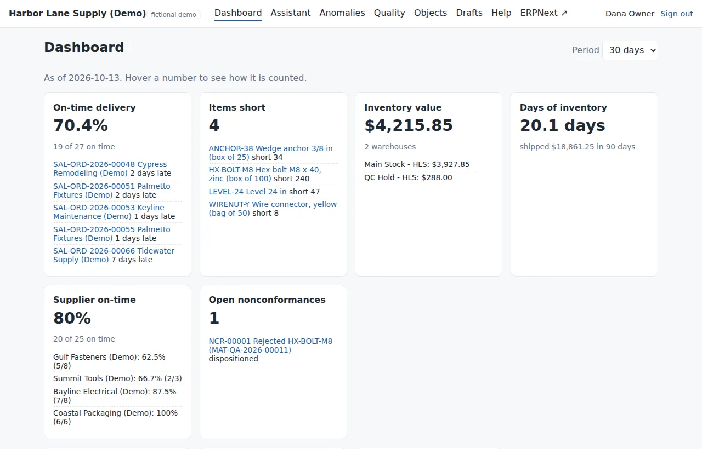

# Dashboard

The dashboard shows the last 7, 30 or 90 days. Hover a number to see exactly how it is counted.

| Number | How it is counted |
| --- | --- |
| On-time delivery | Sales orders fully delivered in the period whose last delivery note is on or before the delivery date |
| Items short | Stock items whose stock on hand (not counting quarantine) is less than what open orders still need |
| Inventory value | The stock ledger's value, by warehouse |
| Days of inventory | Inventory value ÷ average daily value shipped over the last 90 days |
| Supplier on-time | Receipt lines received on or before the purchase order line's required-by date |
| Open nonconformances | Open nonconformance reports plus rejected inspections that have no report yet |

Each number lists the orders, items or suppliers behind it — click through to check.

**Daily brief.** Every morning at 7:30 (company time) the system writes a short brief: the numbers, new and
critical problems, what is due today and the drafts waiting for you. You only see the parts your role allows.

**Needs attention** lists open anomalies, most serious first.
