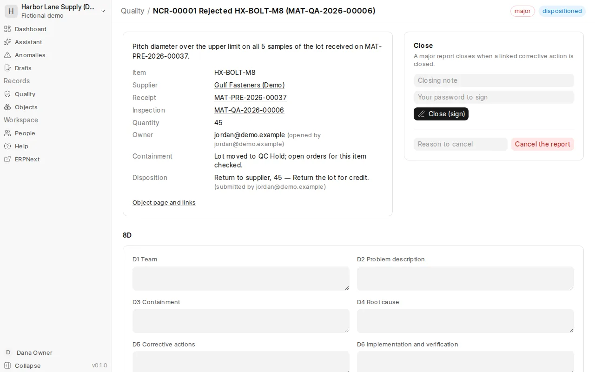
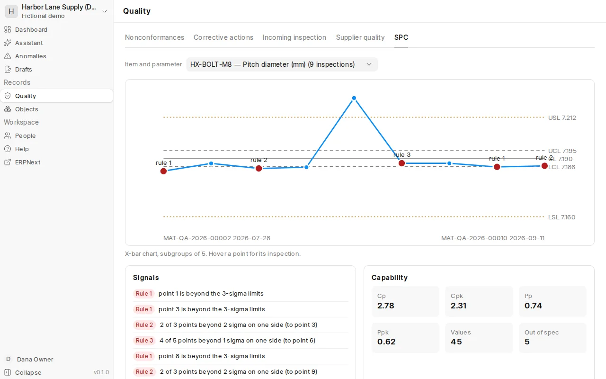
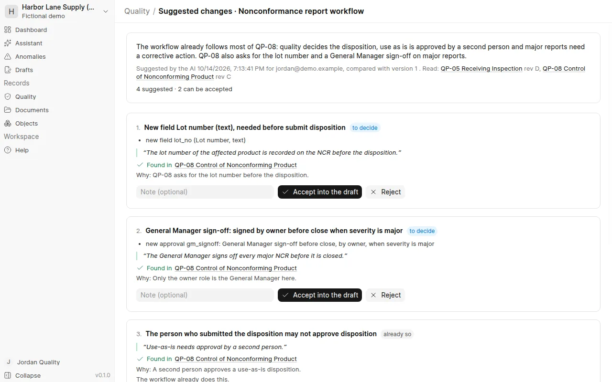

# Quality

## Nonconformance reports (NCR)

A rejected inspection opens a report automatically; you can also open one by hand.

1. **Contain** — what was done so bad parts go no further (for example, moved to QC Hold).
2. **Disposition** — return to supplier, rework / sort, scrap, or use as is (concession), with quantity and reason.
   Types that need approval (such as *use as is*) must be approved by **someone else**, with their password.
3. **Close** — signed with your password. A *major* report closes only after its corrective action is closed.

Reports can be cancelled with a reason. Nothing is deleted.

## 8D

Write the eight sections on the report. *Mark 8D complete* signs it; after that it cannot change.

## Corrective and preventive actions (CAPA)

**Draft → Investigation → Implementation → Effectiveness check → Closed.**

- To start the investigation: problem description, owner and risk level.
- To implement: containment, root cause and at least one action.
- Actions have an owner and a due date; the owner marks them done with evidence — even outside Quality.
- Effectiveness check: *effective* closes it, signed by someone **other than the owner**; *not effective* sends it
  back to implementation with the reason.

## Incoming inspection

Items marked *inspection required before purchase* in ERPNext appear under **Incoming inspection** when received.
Draft an inspection with your sample size; Quality confirms it on the Drafts page; enter the readings in ERPNext.

To inspect by plan and sampling table instead, use **Incoming inspection** in the sidebar:

- **Sampling table**: the owner or Quality enters the rows of the company's sampling table (AQL, inspection level,
  lot size range, sample size n and acceptance number Ac; Re is Ac + 1) from the company's own controlled copy of the
  standard it uses. WenQuest Ops does not supply these numbers. Mark a row as checked, naming the source, once someone
  has compared it with that copy. A row an inspection used cannot change: archive it and add a new one.
- **Plans**: a plan for an item gives its AQL and the characteristics to check: measured ones with a lower and/or upper
  limit, or pass/fail ones. A plan is enabled with a password by someone other than the person who drafted it, and is
  then frozen; a change is a new version.
- **Inspections**: start one from a waiting receipt line (or for a lot not on a receipt). The sampling table gives n,
  Ac and Re for the lot size and the supplier's inspection level; a lot smaller than the sample is inspected piece by
  piece. Enter the readings and sign: the lot is judged by code (a sample unit fails if any reading fails; the lot is
  accepted with Ac or fewer failing units). Someone other than the inspector then releases or rejects the lot with a
  password. The result goes to Drafts as an ERPNext quality inspection to confirm; a rejected lot gets a
  nonconformance report, which is linked to that inspection once it is submitted in ERPNext. A lot sampled with a row
  not yet checked is flagged, and releasing it needs a reason.
- **Inspection levels**: the switching rules suggest moving a supplier's item between normal, tightened and reduced
  inspection from the lots decided at its current level. A person switches, with a reason. The starting rules are
  defaults: set them to what your procedure says. Who may do what (the "someone other" rules) can be switched off
  there too.

## Complaints

**Complaints** in the sidebar records each complaint: when it was received and when the company first knew, from
whom, the product, what happened, whether anyone was hurt and whether the product failed. Give it an owner and start
the investigation; record the root cause and the conclusion (or Quality approves not investigating, with the reason).

Someone other than the owner then decides, with a password, whether it must be reported to a regulator. WenQuest
Ops asks three questions (harm, a malfunction that could cause harm if it happened again, a recall or correction)
and, when one is answered yes, shows that this usually means reporting and the deadline counted from the day the
company first knew. It never decides: a yes with a decision not to report is allowed with its reason and counted as
an exception. The deadlines are the company's settings; set them to what your regulations require. Reports are made
outside WenQuest Ops; enter their reference and date here. Once decided, the investigation and the decision cannot
change.

Someone other than the owner closes the complaint with a password once everything is there (the conclusion, the
report if one was due, the reply to the customer); WenQuest Ops lists what is missing all at once. A nonconformance
report or a corrective action can be opened from a complaint. A duplicate is cancelled with a reason; nothing is
deleted. The ISO complaint checks read these complaints as well as the complaints register.

## Measuring equipment

**Measuring equipment** lists the company's gauges and instruments with how often each is calibrated. New equipment is
out of service until its first good calibration is approved. Record each calibration (date, who did it, the
certificate, pass or out of tolerance, as found and as left); someone other than whoever recorded or last changed it
approves it with a password. A good calibration sets the next due date; an older one than the last good calibration
cannot be approved.

When a calibration finds the equipment out of tolerance, approving it takes the equipment out of service and lists
the incoming inspections it measured since its last good calibration. Quality writes whether those results still
stand and signs (a nonconformance report can be opened at the same time). The equipment returns to service once that
assessment is signed and a good calibration after the failure is approved.

Once any equipment is registered, an incoming inspection names the equipment used for each measured characteristic,
and the inspector can only sign if that equipment is in service and not past its due date on that day; what was used,
and when it was due, stays with the inspection. This can be switched off under *Incoming inspection → Inspection
levels → Who may do what*. The ISO calibration check reads this list as well as the calibration register.

## Changes

**Changes** records changes to a product, process, supplier, document, software or equipment. Raise one as a draft:
what changes, why, its owner, the documents in effect it changes, and four questions a person answers (does it affect
product already released; could it need a regulatory submission or notification; does the risk file need updating;
does it need verification or validation first). A yes to the regulatory question needs the regulatory decision; a yes
to validation needs the plan. Submitting fixes what was assessed (Quality can send it back with a reason; the target
date can still move, and every move is logged). Someone who did not raise, own, submit or edit the change approves
it with a password. It is marked implemented once the new revision of each document it changes is in effect and,
when needed, the validation result is written; someone other than the owner closes it with a password after the
effectiveness check. A change is cancelled with a reason before it is implemented; nothing is deleted.

## Approved suppliers

**Approved suppliers** in the sidebar lists which supplier may deliver which item: one entry per supplier and item,
or per supplier for all its items (an entry for the item counts first). Quality or the owner enters a supplier as a
draft with its risk, what the approval rests on (certificates, audit, sample inspection) and when to re-evaluate it;
someone else approves it with a password. With conditions written in, the approval is *conditional*. An approved
entry changes only by a signed re-evaluation (with a later re-evaluation date), or after it is suspended. Suspending,
disqualifying and qualifying again (back to a draft) need a reason. Nothing is deleted.

Incoming inspection reads the list: a lot from a supplier with no approved entry for the item cannot be inspected (a
supplier suspended or disqualified for all items is blocked for every item); a
conditional supplier or an overdue re-evaluation is flagged on the inspection. Purchase order drafts list any item
the supplier is not approved for. The list also shows each entry's inspected lots, rejection rate and open
nonconformances. If the ISO 9001 supplier approval register was used, *Bring in from the register* makes a draft
entry for each supplier ERPNext knows, with the register's basis and next review, for someone else to approve (a
removed supplier comes in disqualified); from then on the ISO supplier check reads the list, item by item. The list is
in use once it has an entry: before that, incoming inspection does not consult it. Both rules (the list is enforced;
approval by someone other than whoever entered or last changed the entry) can be switched off at the bottom of the
page.

## Supplier quality

Facts per supplier: lots inspected and rejected, rejection rate, on-time rate, NCRs, concessions and open
corrective actions. No made-up score.

## Control charts (SPC)

Numeric readings on ERPNext inspections become control charts per item and parameter: X-bar and R when every
inspection has the same number of readings (2–10), otherwise individuals. Points that break a Western Electric rule
are marked. With spec limits you also get Cp, Cpk, Pp and Ppk.

## Signatures

Signing means re-entering **your own WenQuest Ops password**. If you sign in with Microsoft or Google, set a password
first. Signatures and the quality history can never be changed or deleted.

## Workflows

*Quality → Workflows* shows how nonconformance reports and corrective actions move: their states in order and, for
every step, who may do it, what it needs, whether it is signed and who may not do it (for example, the person who
submitted a disposition cannot approve it). These rules are a configuration that WenQuest Ops checks before every
step; each report and action keeps the version it was opened under, shown at the top of its page. Signing,
approval by someone else and the record history cannot be switched off by any configuration.

**Changing a workflow.** People with the right to change workflows (the owner and Quality) choose *Change this
workflow*. The new version starts as a draft copy of the one in use. You can rename states and steps, word the
signatures, add what a step needs, keep more people from a step, limit a step to some roles, add your own fields
(for example a lot number, needed before containment), add extra signed approvals (for example "the owner approves
closing a major report") and tighten the rules. The page shows every change from the version in use and checks the
rules that cannot be switched off. Someone who did not change the draft enables it with their password; reports and
actions opened before keep their version.

**Suggestions from your procedures.** With the company's model key, the same people can let the AI read the
procedures in effect in the document library (approved there; those about nonconformances or corrective actions are
ticked first) and suggest changes to the workflow, for example "QP-08 asks for the lot number before the disposition". Every
suggestion quotes the procedure. WenQuest Ops checks that the quote is really in that procedure and that the change
keeps the rules that cannot be switched off. A suggestion can only tighten the workflow: it cannot let more roles do a
step, nor make a step need something no one can fill in by then. Suggestions that fail, or that the workflow already
does, cannot be accepted. You accept or reject each one. Accepted ones go into the draft (a new one is made when there is none), and
someone who did not change the draft enables it with their password, as above. The AI never changes the workflow
itself. What a procedure asks that a workflow cannot do is listed separately, for a person to handle.

