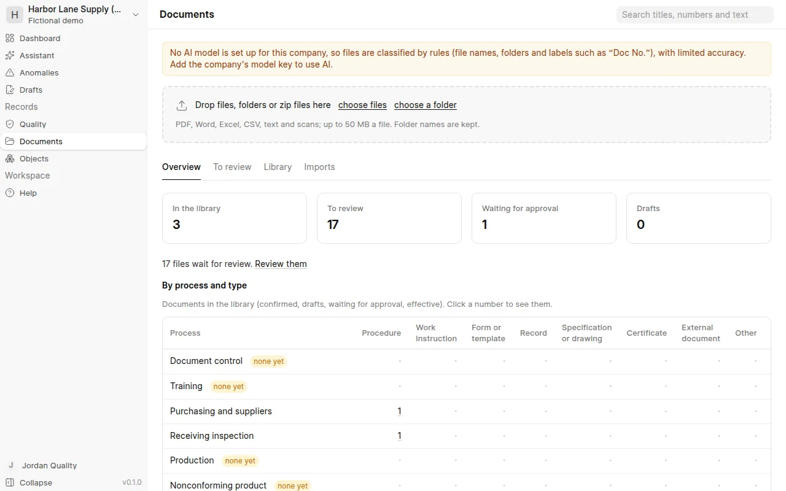
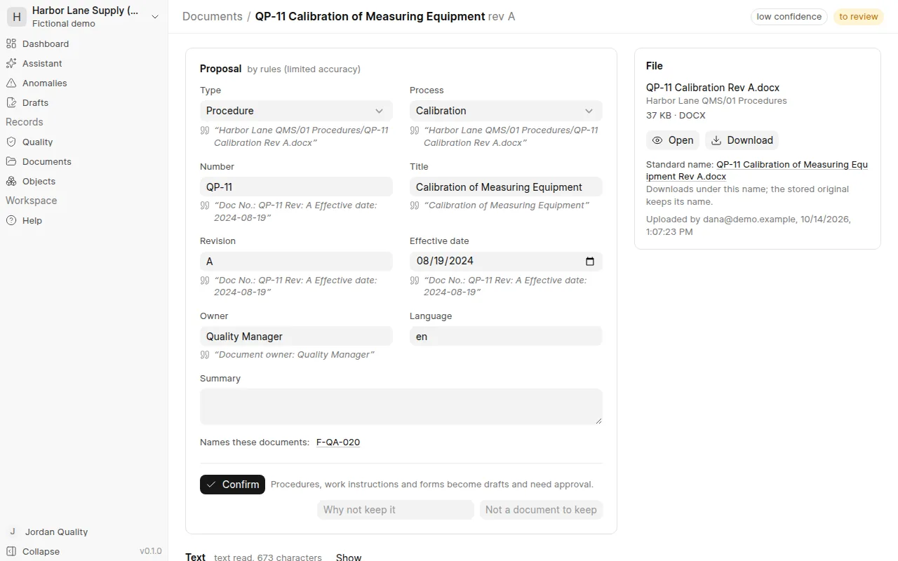
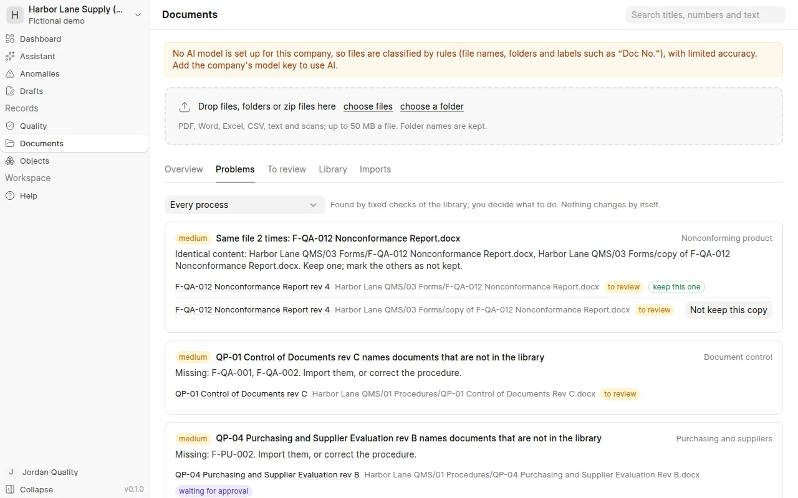
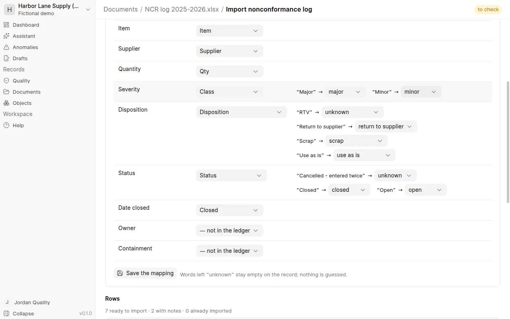

# Documents

The document library keeps the company's procedures, work instructions, forms, records and certificates in one place
that can be searched, with the right revision of each.

## Bring your files in

Drop files, whole folders or zip files on the *Documents* page (or use *choose files* / *choose a folder*).
PDF, Word, Excel, CSV, text and scanned images are taken, up to 50 MB a file. Folder names are kept: they help to
sort the files. The text is read on your own server; scans are read with OCR.

Nothing goes to the AI until you choose. On the *Imports* tab, each import shows how many files the AI would read and
roughly how many tokens that is (with the company's own key); then choose **Classify with AI**. Without a key the
files are classified by rules (file names, folders and labels such as "Doc No."), with limited accuracy.

## Review what the AI proposes

For each file the AI proposes the type, the process, the number, title, revision, effective date and owner, a short
summary, and the forms and records a procedure names. **Every field quotes the file.** WenQuest Ops checks each
quote against the file; a quote it cannot find is marked, and you should check that field.

- Proposals with high confidence and every quote found can be confirmed together (*To review* → *Select* →
  *Confirm*).
- Open the others, correct what is wrong and *Confirm*. Your corrections are remembered and given to the AI next
  time, so it learns how your company names and sorts things.
- A file that is not worth keeping (a stray copy, a scrap note): give the reason and choose *Not a document to keep*.

## Controlled documents

- **Records, certificates and outside documents** are kept as soon as they are confirmed. Their file is frozen: it
  can never be replaced.
- **Procedures, work instructions and forms** become drafts. *Send for approval*; then someone who did not upload,
  confirm or send it approves it with their password. It becomes **effective** and its file is frozen.
- **A new revision**: on the effective document, upload the next revision. It goes through approval too; when it is
  approved, the old revision becomes obsolete automatically (and stays available).
- *Make obsolete* needs a reason. The history and signatures cannot be changed or deleted.

## Overview

The *Overview* tab counts the documents by process and type. A process with *none yet* has no document in the
library — a first sign of a gap; the *Problems* column counts what the checks found for each process.

## Problems

The *Problems* tab lists what fixed checks found in the library — they never change anything by themselves:

- **Same file twice** — keep one, choose *Not keep this copy* for the others.
- **Several revisions of one number** — the current one is marked; keep the older ones *as obsolete*, so their
  history stays findable but they are never used.
- **One number for different documents**, or the same revision twice — give one of them another number or revision.
- **No number, no revision, no effective date** — a number is suggested in your own style (*Use the suggested
  number*, then confirm or save).
- **Forms a procedure names that are not in the library**, forms without any record, records without a procedure,
  and processes with no documents — the first view of the gaps in your system.

**Numbering.** Suggested numbers follow the convention learned from the numbers your documents already have (for
example F-QA-013 after F-QA-012). You can set your own rule per type, such as `F-{process}-{seq}` with 3 digits.
A document's page also offers its standard file name (`QP-05 Receiving Inspection Rev D.pdf`) for downloads; the
stored original keeps its own name.

## Old ledgers: NCR log, CAPA log, supplier list

A spreadsheet in the library can bring its rows into WenQuest Ops. Open it and choose **Read the ledger**:

1. The AI looks at the columns and a sample of rows and proposes what the ledger is (nonconformance log, corrective
   action log or supplier list), which column fills which field, and how the ledger's words map to ours ("RTV" →
   return to supplier). Without a key the rules match the column names.
2. You check every field and every word. A word left *unknown* stays empty on the record; nothing is guessed. The
   rows below show what each would become, with notes on dates or values that could not be read.
3. **Import (sign)** with your password. Code creates the records; the AI never writes data.

- Each NCR and corrective action keeps the ledger's number and dates and names the file and row it came from. Rows
  closed in the ledger stay closed ("closed before WenQuest Ops"); open ones continue here. A corrective action is
  linked to its NCR when the ledger names one that was imported.
- A supplier list makes a draft for each supplier not yet in ERPNext; Purchasing confirms them on *Drafts*.
- A row is imported once: reading the same ledger again skips the rows already brought in.

Importing NCR and CAPA logs needs the right to edit quality records; importing a supplier list needs the right to
draft purchases.
