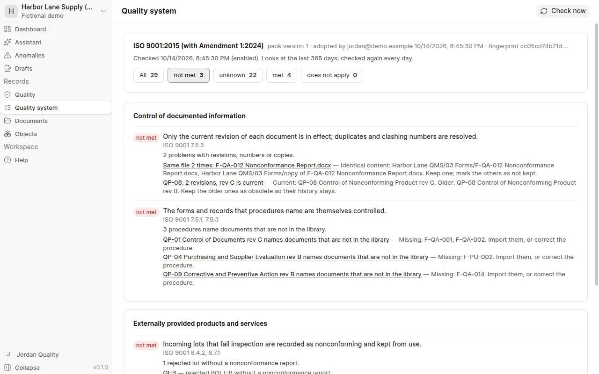

# Quality system

*Quality system* checks your company against a standard, starting with ISO 9001. WenQuest Ops turns the standard into
control points, things your records must be able to show, and checks each one against what is in the system:
nonconformance reports, corrective actions, incoming inspections and the document library.

## Adopt the standard

The owner or Quality chooses the edition and adopts the standard with their password. ISO 9001:2015 is available now;
ISO 9001:2026 follows once its clause references have been checked against the published text. The requirement
summaries are our own words, not the standard's text, and WenQuest Ops does not certify anyone: certification is
for a certification body.

## Met, not met, unknown

Each control point shows one of:

- **met**: the records show it, with links to them;
- **not met**: the records show a gap, listed with each record and what is wrong, for example a major
  nonconformance without a corrective action, or a concession approved by the person who proposed it;
- **unknown**: there is nothing to judge yet, for example no reports in the last year, or the evidence comes from a
  register that is not there yet. Unknown is never counted as met;
- **does not apply**: the company declared it, with a reason.

The check looks at records still open and at those closed in the last year. It runs again every day (with the
background job that also pulls changes from ERPNext), whenever someone who edits quality records chooses *Check now*,
and when you declare something or link a document. Every check is kept: *Earlier checks* shows what the system looked
like on a given day. Records imported from old spreadsheets that were already closed are counted as history, not
judged, because they were not made under these rules; imported records still open are judged like any other.

Where WenQuest Ops checks a requirement with a rule of its own, for example "every major nonconformance gets a
corrective action within 14 days" or "a concession is approved by someone other than the person who proposed it",
the control point says so. These rules are one way to show the requirement is met; the standard itself allows others.
Under *Settings* at the bottom of the page you can change the numbers of days, or switch one of these rules off and
link your own procedure for that control point instead. Changes are recorded and the system is checked again.

## Say what does not apply, link documents

Some requirements may not apply to your company, such as design and development when you only distribute. Choose
*Change* on the control point, give the reason and sign with your password. Others are shown by a document, such as
the scope statement, the quality policy or a process map: link a document from the library. It counts while it is in
effect: approved, for procedures, work instructions and forms; confirmed and not obsolete, for other documents such as
a policy kept as a record. The scope is met when the scope statement is linked and every requirement that may not
apply has been declared one way or the other.

## Registers

The standard also asks for records that are not nonconformances or documents. *Quality system* has a register for
each: training and competence, measuring equipment and calibration, internal audits, management reviews, quality
objectives, risks and opportunities, customer feedback and complaints, and supplier approval. Open one from the
*Registers* box, record entries with the form, and change them while they are open. Internal audits and management
reviews are approved with your password and then locked. A wrong entry is voided with a reason; nothing is deleted
and every change is kept.

The checks read the registers: training not expired or followed up, equipment calibrated and not due, an approved
internal audit and management review within the set number of days, each objective and risk reviewed in time,
complaints answered in time, and every supplier you bought from in the last year approved. The numbers of days are
under *Settings*. An empty register gives "unknown" until you start using it.

An old spreadsheet, such as a training matrix or a calibration log, comes in like a nonconformance log: upload it
under *Documents*, open it and import it as "Register: …". The columns are matched to the register's fields for you
to check before the signed import.

## Gap report and to-dos

*Gap report* lists every control point not met or unknown, by process, with the records behind it. Give each a to-do
with an owner and a due date, or choose *A to-do for every gap*. When a later check finds the point met, the to-do
is closed by the check itself; you can also mark it done, or drop it with a reason. Closed to-dos are kept.

Where a document is missing, such as the quality policy, people who adopt standards can choose *Draft the document
with AI* (with the company's model key). The draft goes into *Documents* marked as a draft written by AI, with
"[to fill: ...]" wherever it needs your facts and a list of what to fill in. It is not in effect until you review it,
confirm it and someone approves it; then link it to the control point.

## Internal audit checklist

*Audit checklist* turns the control points of a process into questions for the auditor, each with what the records
show, a sample of records to look at and the gaps found. Print it, take it to the audit, and record the audit and
its findings in the internal audits register.

## Set up

*Set up* (on the *Quality system* page) helps fit the standard to your company:

1. **About the company.** A few questions: what you make or provide, whether you design products, hold customers'
   property, do anything after delivery, use measuring equipment. The answers say which requirements may not apply;
   you declare them with your password in one go.
2. **From your own procedures.** With the company's model key, the AI reads the procedures you choose (those in effect)
   and suggests settings (for example how often gauges are calibrated), what does not apply and which procedure shows a
   requirement. Each suggestion quotes the procedure and WenQuest Ops checks the quote is there. You accept or reject
   each one; accepting makes the change as you would by hand, and a declaration still needs your password. Changes to
   how nonconformances and corrective actions flow are suggested on *Quality → Workflows*.
3. **Procedures written from the workflow.** WenQuest Ops writes the nonconformance and corrective action procedures
   from the workflows in use, so the procedure says exactly what the system does. They go into *Documents* to review
   and take effect once someone else approves them. When a workflow changes, the page says so: write it again.
